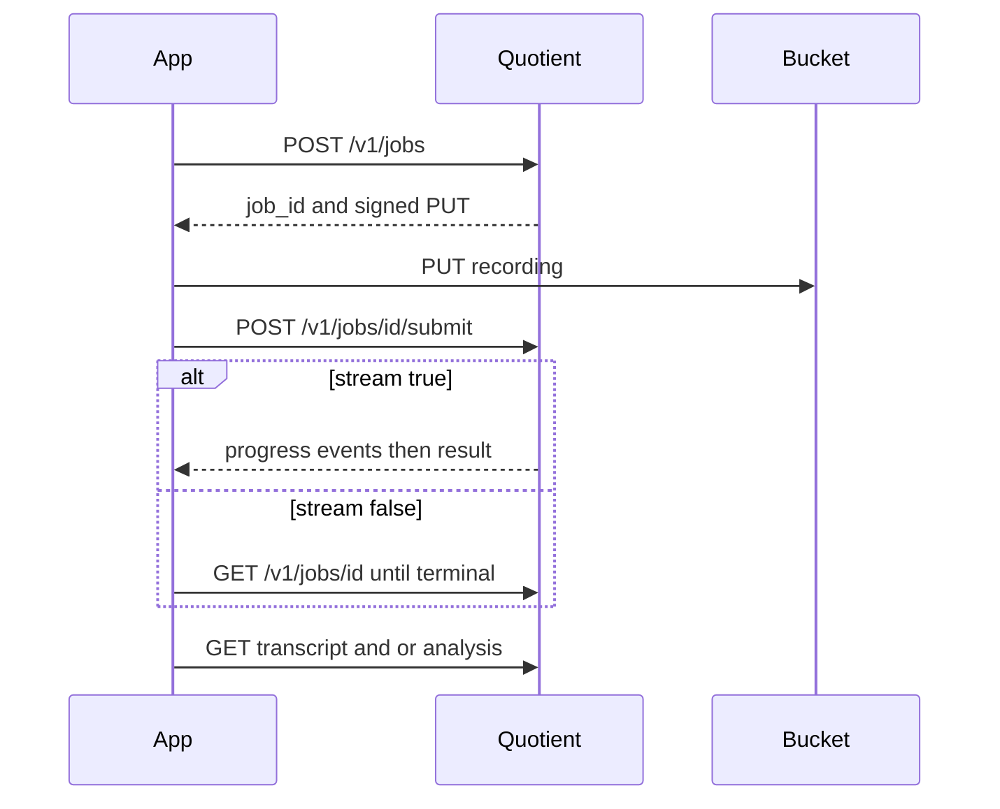

# Quotient API

This document is the partner contract for the Quotient HTTP API. External apps use it to submit an audio or video recording, with or without context, and to read the raw transcript, the analysis, or both. The Quotient portal does not use these routes for its own meetings. Assistants that speak MCP use [MCP.md](MCP.md).

The local default origin is `http://127.0.0.1:8080`. The AWS staging origin is the internet-facing load balancer in `ap-southeast-2`, `http://axion-meeting-staging-315925467.ap-southeast-2.elb.amazonaws.com`, on HTTP port 80. Paths below are the same on both origins.

## Endpoint

| Item | Value |
| --- | --- |
| Local base URL | `http://127.0.0.1:8080` |
| Staging base URL | `http://axion-meeting-staging-315925467.ap-southeast-2.elb.amazonaws.com` |
| Base URL | `{origin}` |
| Jobs | `POST /v1/jobs` |
| Submit | `POST /v1/jobs/{job_id}/submit` |
| Status | `GET /v1/jobs/{job_id}` |
| Cancel | `DELETE /v1/jobs/{job_id}` |
| Events | `GET /v1/jobs/{job_id}/events` |
| Transcript | `GET /v1/jobs/{job_id}/transcript` |
| Analysis | `GET /v1/jobs/{job_id}/analysis` |
| Request body | `application/json` |
| CORS | Any origin. The key is still required. |

`POST /v1/jobs` answers `202` with a job id. It does not wait for the recording to finish. Upload the bytes, then call submit. Poll the job, or hold the event stream when `stream` is true.

## Authorization

One API key. Create it, show it, copy it, and revoke it on the Settings page. It does not expire. A revoked key is rejected. Generate a new one only after the active key is revoked.

Send it on every job route:

```
Authorization: Bearer qnt_<key_id>_<secret>
```

A missing or revoked key receives HTTP 401 and `{"error":"unauthorized"}`. The key is not an MCP access token, and an MCP access token is not accepted here.

Key routes (`POST /v1/keys`, `GET /v1/keys`, `POST /v1/keys/revoke`) accept a connection from this computer only. The load balancer cannot mint or read the key. Settings calls those routes for you.

When Settings says the key is stored on this computer only, the deployed load balancer will not accept it. Point the local API at the deployment's `KEYS_TABLE` before generating a key that must work there.

## What you send

`POST /v1/jobs`

| Field | Required | Meaning |
| --- | --- | --- |
| `media` | yes | A new file (`filename`, `media_type`, `byte_size`) or a stored `object_key`. Audio or video only. Not both. |
| `context` | no | `purpose` (at most 2000 characters), `names` (up to 32 short proper nouns), and `files` (reference documents). |
| `outputs` | yes | `transcript` and/or `analysis`. At least one. |
| `stream` | yes | `true` opens the event stream. `false` means poll. |
| `idempotency_key` | no | The same key and API key return the same job until that job fails or is cancelled. |

`outputs.transcript` is `true` or `false`.

`outputs.analysis` is `true` for every section, or an object whose fields are `summary`, `decisions`, `actions`, `questions`, and `findings`. Each field is `true` or `false`. Omitted sections are absent from the analysis response.

`context.files` follows the same limits as the product: at most 20 files, 25 MB each, 100 MB in all. Supported reference types are PDF, Word, PowerPoint, Excel, CSV, JSON, HTML, XML, EPUB, Markdown, and text. Context is reference material. It is not treated as what was said.

A new recording receives a signed `PUT` in `upload`. Context files receive signed `PUT`s in `context_uploads`. Send each file with the returned method, URL, and headers. Then:

```json
{ "upload_complete": true }
```

to `POST /v1/jobs/{job_id}/submit`.

A stored `object_key` has no `upload` field. Call submit after the object is already in the bucket.

Quotient runs the full meeting pipeline either way. The output spec only chooses what the responses include. A transcript-only job still analyses the recording; `GET .../analysis` then answers 404. An analysis-only job answers 404 on `GET .../transcript`.

## What you receive

Job status is `awaiting_upload`, `queued`, `working`, `ready`, `needs_review`, `failed`, or `cancelled`.

`progress_message` is the current stage, such as waiting for the upload or reading the recording.

The transcript is the raw recording text. `audio` joins what was heard, in time order. `video` joins what was seen, in time order. It is not the edited transcript.

The analysis is included when the job is `ready` or `needs_review`. `status` says which. Sections you did not ask for are absent.

| Section | Contents |
| --- | --- |
| `summary` | `title`, `summary`, `outcome` |
| `decisions` | Decisions grounded in the recording |
| `actions` | Actions grounded in the recording |
| `questions` | Open questions |
| `findings` | Published findings |

`GET .../events` exists only when `stream` was `true`. Otherwise it answers 404 and the client polls `GET /v1/jobs/{job_id}`. The stream is `text/event-stream`:

- `event: progress` with `status` and `progress_message`
- `event: result` once, with the transcript and analysis that were requested
- a comment line (`: keepalive`) about every 15 seconds while the job is still running

`DELETE /v1/jobs/{job_id}` cancels the job.

## Sequence

1. `POST /v1/jobs` with the recording, any context, the outputs, and `stream`.
2. `PUT` the recording and any context files to the signed URLs.
3. `POST /v1/jobs/{job_id}/submit` with `upload_complete: true`.
4. If `stream` is false, poll `GET /v1/jobs/{job_id}` until the status is `ready`, `needs_review`, `failed`, or `cancelled`. If `stream` is true, hold `GET /v1/jobs/{job_id}/events` until the `result` event.
5. `GET /v1/jobs/{job_id}/transcript` and `GET /v1/jobs/{job_id}/analysis` for the pieces you asked for. The `result` event already carries those bodies when streaming.



## Examples

Transcript only, no context, poll:

```json
{
  "media": {
    "filename": "standup.mp4",
    "media_type": "video/mp4",
    "byte_size": 1048576
  },
  "outputs": { "transcript": true },
  "stream": false
}
```

```json
{
  "job_id": "a1b2c3d4e5f678901234abcd",
  "status": "awaiting_upload",
  "stream": false,
  "outputs": { "transcript": true, "analysis": [] },
  "progress_message": "Waiting for the recording to upload.",
  "meeting_id": null,
  "upload": {
    "method": "PUT",
    "url": "https://bucket.example/uploads/a1b2c3d4e5f678901234abcd/standup.mp4?...",
    "headers": { "Content-Type": "video/mp4" },
    "object_key": "uploads/a1b2c3d4e5f678901234abcd/standup.mp4"
  }
}
```

After submit and completion:

```json
{
  "job_id": "a1b2c3d4e5f678901234abcd",
  "meeting_id": "m1",
  "status": "ready",
  "transcript": {
    "audio": "We will ship on Friday.",
    "video": "A slide says Friday."
  }
}
```

Analysis with context, poll. `purpose` and `names` need no upload. Files do.

```json
{
  "media": {
    "filename": "review.m4a",
    "media_type": "audio/mp4",
    "byte_size": 524288
  },
  "context": {
    "purpose": "Decide whether the Friday release holds.",
    "names": ["Ada", "Kai"],
    "files": [
      { "filename": "brief.pdf", "media_type": "application/pdf", "byte_size": 8192 }
    ]
  },
  "outputs": {
    "analysis": { "summary": true, "decisions": true, "actions": true }
  },
  "stream": false
}
```

The analysis response includes only those sections:

```json
{
  "job_id": "b2c3d4e5f678901234abcdef",
  "meeting_id": "m2",
  "status": "needs_review",
  "analysis": {
    "title": "Friday release",
    "summary": [{ "text": "The group will ship on Friday.", "span_ids": ["s1"] }],
    "outcome": null,
    "decisions": [{ "statement": "Ship on Friday.", "span_ids": ["s1"] }],
    "actions": [{ "task": "Ship the build.", "span_ids": ["s1"] }]
  }
}
```

Transcript and analysis, streaming. `stream: true` adds `events_url`. Hold that URL and read `progress`, then one `result`:

```
event: progress
data: {"job_id":"c3","status":"working","progress_message":"Reading the recording."}

event: result
data: {"job_id":"c3","meeting_id":"m3","status":"ready","transcript":{"audio":"We will ship on Friday.","video":""},"analysis":{"title":"Friday ship","summary":[],"outcome":null,"decisions":[],"actions":[],"questions":[],"findings":[]}}
```

Create that job with:

```json
{
  "media": { "object_key": "uploads/demo/call.mp4" },
  "outputs": { "transcript": true, "analysis": true },
  "stream": true
}
```

`analysis: true` means summary, decisions, actions, questions, and findings.

## Errors

| HTTP | When |
| --- | --- |
| 400 | The JSON, the output spec, the media type, or `upload_complete` is wrong. |
| 401 | The key is missing or revoked. |
| 403 | A key was minted or read from somewhere other than this computer. |
| 404 | The job is not yours, the output was not requested, or streaming was left off. |
| 409 | A key already exists, or the transcript or analysis is not ready. |
| 503 | Object storage is not configured for a new upload. |

A job that is still `queued` or `working` answers 409 on the transcript and analysis routes. Read `progress_message` on the job and try again. A failed or cancelled job names that in `failure_message`.
