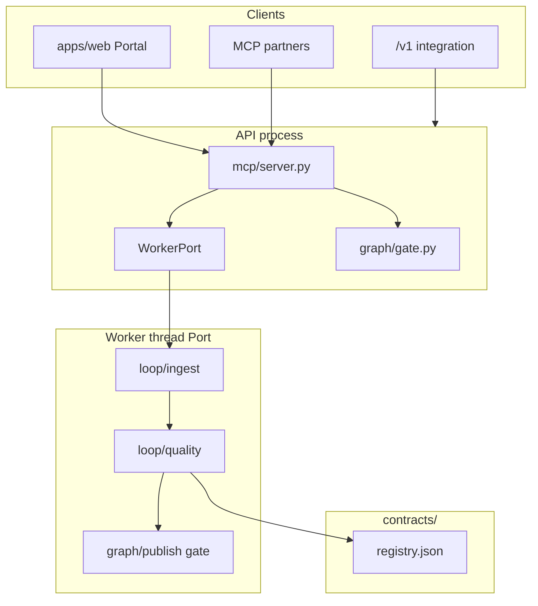
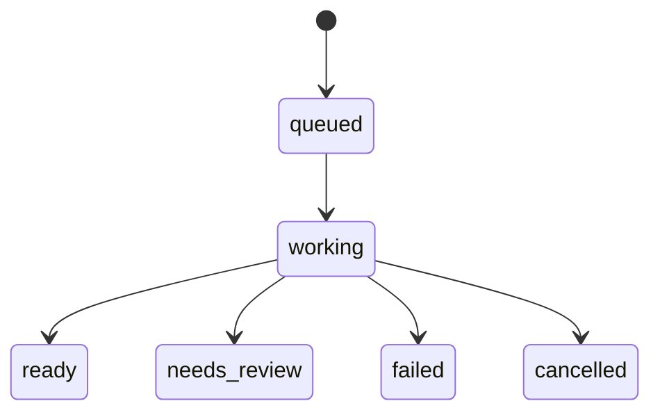

# Quotient — Repository Architecture

Evidence-backed architecture map for the **meeting** repository (product name: **Quotient**). Generated from source inspection, `graphify-out/` (commit `1b50ce87` in graph manifest; working tree at `648c9ed`), and authoritative docs (`README.md`, `MCP.md`, `contracts/registry.json`, `docs/quality-ledger.md`).

## Preservation ledger (baseline)

| Item | Value |
| --- | --- |
| Branch | `quotient/walkaway-digest-and-hardening` |
| HEAD | `648c9ed` — Reload staging meetings from the artifacts bucket after a task replacement |
| Dirty files | none at documentation time |
| Graph freshness | `graphify-out/` built from `1b50ce87`; run `graphify update .` after code changes |

## Source-of-truth precedence

1. **Runtime contracts** — `contracts/registry.json`, paired `contracts/prompts/*.yaml` and `contracts/schemas/*.json` (loaded by `apps/worker/registry/load.py`).
2. **Partner contract** — `MCP.md` (MCP tools, resources, limits; protocol `2025-11-25`).
3. **Quality claims** — `docs/quality-ledger.md` (not duplicated here).
4. **Human docs** — `README.md`, `docs/local-development.md`, `docs/staging.md` (may lag CDK; gaps listed in [ARCHITECTURE_GAPS.md](./ARCHITECTURE_GAPS.md)).
5. **This architecture pack** — derived; every node should trace to code.

## System purpose

Quotient turns a recorded meeting into an evidence-linked brief: published statements must cite verbatim transcript spans; unconfirmed statements are withheld (`README.md`, enforced in `apps/worker/graph/publish.py` and `apps/api/quotient/graph/gate.py`).

**Status (README):** pre-release; end-to-end on a local machine; staging stack deployed but durable meeting state not in DynamoDB.

## Technology stack

| Layer | Technology | Location |
| --- | --- | --- |
| API / MCP | Python 3.11+, Starlette, uvicorn | `apps/api/quotient/` |
| Analysis worker | Same process as API locally; separate ECS service in CDK | `apps/worker/` |
| Portal | Next.js 15, React 19 | `apps/web/` |
| Media | ffmpeg/ffprobe, isolated pyannote diarizer, MarkItDown context venv | `apps/worker/media/`, `scripts/setup-*.sh` |
| Models | Amazon Bedrock (Nova Sonic, Claude Haiku 5.5 for both reasoning roles, Pegasus) | `apps/worker/bedrock/`, `sonic/`, `pegasus/` |
| IaC | AWS CDK (Python 3.12 venv) | `infra/cdk/` |
| Tests | pytest (worker, api, contracts, jev); Node test runner (web) | `tests/`, `apps/web/tests/` |

## Master architecture

Full diagram (external services, staging, state stores): [diagrams/01-master-system.mmd](./diagrams/01-master-system.mmd).

## Architectural layers

### 1. Client layer (`apps/web`)

Single App Router app; meeting workspace at `/meetings/[id]`. Browser MCP client (`lib/mcp/client.ts`) talks to same-origin `/mcp`, rewritten to the Quotient server (`next.config.mjs`). No meetings REST API.

See [diagrams/11-web-dataflow.mmd](./diagrams/11-web-dataflow.mmd).

### 2. API / integration layer (`apps/api/quotient`)

One Starlette app (`create_app` in `app.py`):

- **MCP** — Streamable HTTP at `/mcp`; JSON-RPC dispatch in `mcp/server.py`.
- **OAuth resource server** — `auth/context.py`, `auth/metadata.py`; scope `quotient:meetings`.
- **Public integration API** — `/v1/jobs`, `/v1/keys` (`public/routes.py`); bearer keys are not MCP OAuth tokens.
- **Projection** — `graph/gate.py` `project_meeting` strips secrets and withholds brief until `ready`.
- **Exports** — `export/project.py` renders all exports except `burned.mp4` (worker-only).

Worker boundary: `worker/port.py` `WorkerPort` implemented by dynamically loaded `apps/worker/quotient/port.py` `Port`, or `MemoryPort` fallback.

See [diagrams/02-api-mcp-rpc.mmd](./diagrams/02-api-mcp-rpc.mmd).

### 3. Analysis worker (`apps/worker`)

Orchestration hub: `quotient/port.py` `Port._run_meeting` → `loop/ingest.assemble` → `loop/quality.run` → `graph/publish.gate` → `_project`.

Model calls go through `bedrock/reason.py` `Reasoner` + `registry/load.py` `Registry` (contract pins).

See [diagrams/03-worker-pipeline.mmd](./diagrams/03-worker-pipeline.mmd), [04-claim-finalize.mmd](./diagrams/04-claim-finalize.mmd), [05-publish-gate.mmd](./diagrams/05-publish-gate.mmd).

### 4. Contracts (`contracts/`)

`registry.json` lists every active route (pass, prompt_id, schema_id, model_role). Worker validates all structured model output against schemas (`registry/check.py`).

See [diagrams/09-contracts-routes.mmd](./diagrams/09-contracts-routes.mmd).

### 5. Infrastructure (`infra/cdk/`)

`StagingStack` composes VPC, S3, DynamoDB, Cognito, ECS (api/web/worker), SQS work queue, Step Functions `MeetingMachine`, alarms. **Synthesis only** from `app.py` (no deploy in repo).

See [diagrams/10-infra-staging.mmd](./diagrams/10-infra-staging.mmd).

## Runtime topologies

### Local (primary implemented path)

`scripts/start-local.sh` starts uvicorn (`quotient.app:create_app`) on `127.0.0.1:8080` and Next.js on `:3000`. Worker is **in-process**: `load_worker_port()` imports `apps/worker/quotient/port.py`. State file: `.local/run/meetings.json` when `QUOTIENT_ENVIRONMENT=local`.

### Staging (partial)

Fargate services and data plane exist in CDK; README documents meeting rows still in API process memory, not DynamoDB tables. `STATE_MACHINE_ARN` is injected into API/worker containers but **no reference under `apps/`** — Step Functions workflow is infrastructure-only relative to current application code.

## Meeting lifecycle

Detail: [diagrams/06-meeting-lifecycle.mmd](./diagrams/06-meeting-lifecycle.mmd).

## Navigation — detailed diagrams

| ID | File | Scope |
| --- | --- | --- |
| D01 | [01-master-system.mmd](./diagrams/01-master-system.mmd) | End-to-end system |
| D02 | [02-api-mcp-rpc.mmd](./diagrams/02-api-mcp-rpc.mmd) | MCP RPC and tasks |
| D03 | [03-worker-pipeline.mmd](./diagrams/03-worker-pipeline.mmd) | Ingest + quality pipeline |
| D04 | [04-claim-finalize.mmd](./diagrams/04-claim-finalize.mmd) | Claim confirmation |
| D05 | [05-publish-gate.mmd](./diagrams/05-publish-gate.mmd) | Publish gate states |
| D06 | [06-meeting-lifecycle.mmd](./diagrams/06-meeting-lifecycle.mmd) | Row status machine |
| D07 | [07-sequence-submit.mmd](./diagrams/07-sequence-submit.mmd) | submit_meeting sequence |
| D08 | [08-data-entities.mmd](./diagrams/08-data-entities.mmd) | Provenance graph ER view |
| D09 | [09-contracts-routes.mmd](./diagrams/09-contracts-routes.mmd) | Registry → Reasoner |
| D10 | [10-infra-staging.mmd](./diagrams/10-infra-staging.mmd) | CDK staging stack |
| D11 | [11-web-dataflow.mmd](./diagrams/11-web-dataflow.mmd) | Portal MCP flow |

## Related documents

- [COMPONENT_INVENTORY.md](./COMPONENT_INVENTORY.md) — components → source paths → diagram IDs
- [EXECUTION_TRACES.md](./EXECUTION_TRACES.md) — verified entry-to-exit walks
- [ARCHITECTURE_GAPS.md](./ARCHITECTURE_GAPS.md) — unwired infra, doc drift, uncertainties

## Validation notes

- Mermaid files validated with `@mermaid-js/mermaid-cli` (see CI/local: render `01-master-system.mmd`).
- Graphify graph may be one commit behind HEAD; re-run `graphify update .` after substantive edits.
- Planned or CDK-only components are marked dashed or listed in gaps, not as implemented application paths.
